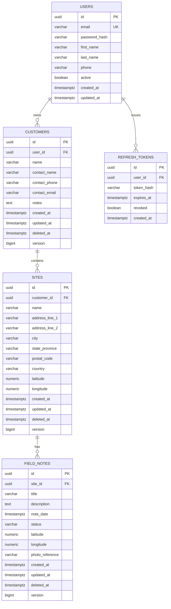

# PostgreSQL schema and ER design

## Table overview

The schema is intentionally normalized and user-scoped.

### users

| Column | Type | Constraints |
| --- | --- | --- |
| id | UUID | PK, default gen_random_uuid() |
| email | VARCHAR(255) | NOT NULL, UNIQUE |
| password_hash | VARCHAR(255) | NOT NULL |
| first_name | VARCHAR(100) | NULL allowed |
| last_name | VARCHAR(100) | NULL allowed |
| phone | VARCHAR(50) | NULL allowed |
| active | BOOLEAN | NOT NULL, default true |
| created_at | TIMESTAMPTZ | NOT NULL, default now() |
| updated_at | TIMESTAMPTZ | NOT NULL, default now() |

### customers

| Column | Type | Constraints |
| --- | --- | --- |
| id | UUID | PK |
| user_id | UUID | FK to users.id, NOT NULL |
| name | VARCHAR(255) | NOT NULL |
| contact_name | VARCHAR(255) | NULL allowed |
| contact_phone | VARCHAR(50) | NULL allowed |
| contact_email | VARCHAR(255) | NULL allowed |
| notes | TEXT | NULL allowed |
| created_at | TIMESTAMPTZ | NOT NULL |
| updated_at | TIMESTAMPTZ | NOT NULL |
| deleted_at | TIMESTAMPTZ | NULL; non-null means a sync tombstone |
| version | BIGINT | NOT NULL, starts at 0; optimistic revision |

### sites

| Column | Type | Constraints |
| --- | --- | --- |
| id | UUID | PK |
| customer_id | UUID | FK to customers.id, NOT NULL |
| name | VARCHAR(255) | NOT NULL |
| address_line_1 | VARCHAR(255) | NOT NULL |
| address_line_2 | VARCHAR(255) | NULL allowed |
| city | VARCHAR(120) | NULL allowed |
| state_province | VARCHAR(120) | NULL allowed |
| postal_code | VARCHAR(30) | NULL allowed |
| country | VARCHAR(120) | NULL allowed |
| latitude | NUMERIC(9,6) | NULL allowed |
| longitude | NUMERIC(9,6) | NULL allowed |
| created_at | TIMESTAMPTZ | NOT NULL |
| updated_at | TIMESTAMPTZ | NOT NULL |
| deleted_at | TIMESTAMPTZ | NULL; non-null means a sync tombstone |
| version | BIGINT | NOT NULL, starts at 0; optimistic revision |

### field_notes

| Column | Type | Constraints |
| --- | --- | --- |
| id | UUID | PK |
| site_id | UUID | FK to sites.id, NOT NULL |
| title | VARCHAR(255) | NOT NULL |
| description | TEXT | NOT NULL |
| note_date | TIMESTAMPTZ | NOT NULL |
| status | VARCHAR(30) | NOT NULL, check in (PENDING, IN_PROGRESS, COMPLETED) |
| latitude | NUMERIC(9,6) | NULL allowed |
| longitude | NUMERIC(9,6) | NULL allowed |
| photo_reference | VARCHAR(500) | NULL allowed |
| created_at | TIMESTAMPTZ | NOT NULL |
| updated_at | TIMESTAMPTZ | NOT NULL |
| deleted_at | TIMESTAMPTZ | NULL; non-null means a sync tombstone |
| version | BIGINT | NOT NULL, starts at 0; optimistic revision |

### refresh_tokens

| Column | Type | Constraints |
| --- | --- | --- |
| id | UUID | PK |
| user_id | UUID | FK to users.id, NOT NULL |
| token_hash | VARCHAR(255) | NOT NULL |
| expires_at | TIMESTAMPTZ | NOT NULL |
| revoked | BOOLEAN | NOT NULL, default false |
| created_at | TIMESTAMPTZ | NOT NULL |

## Referential integrity and delete behavior

- `users` is the root owner entity.
- `customers.user_id` references `users.id` with `ON DELETE RESTRICT`.
- `sites.customer_id` references `customers.id` with `ON DELETE RESTRICT`.
- `field_notes.site_id` references `sites.id` with `ON DELETE RESTRICT`.
- `refresh_tokens.user_id` references `users.id` with `ON DELETE CASCADE`.
- Customer, site, and field-note deletion is represented by `deleted_at`, not physical deletion. Parent tombstones do not cascade to children; API and sync behavior must define how related records are handled.
- A `version` column is reserved for optimistic conflict detection. Update operations must advance it consistently before the sync API can rely on it.

These foreign keys preserve parent-child integrity and prevent physical deletion from silently removing records needed by synchronization.

## Index recommendations

- `idx_customers_user_id`
- `idx_customers_user_updated_at`
- `idx_customers_name`
- `idx_sites_customer_id`
- `idx_sites_customer_updated_at`
- `idx_sites_name`
- `idx_field_notes_site_id`
- `idx_field_notes_site_updated_at`
- `idx_field_notes_status`
- `idx_field_notes_created_at`
- `idx_refresh_tokens_user_id`
- `idx_refresh_tokens_expires_at`
- Full-text index on `field_notes.title + description` for search support

## Why UUIDs

UUIDs are appropriate because the Flutter app may create records offline before the server sees them. Using client-generated UUIDs means the server can accept inserts without requiring a sequential database-generated key while still preserving global uniqueness.

## ER diagram

## Migration design

Flyway manages schema evolution. `V1__initial_schema.sql` is preserved as the original baseline. `V2__add_sync_tombstones_and_restrict_deletes.sql` adds tombstones/revision columns, replaces cascading deletes with restrictive foreign keys, and adds update lookup indexes. It is forward-only so databases that have applied V1 are upgraded safely.

The database UUID default remains a fallback for callers that omit an ID; supplied client UUIDs are preserved by inserts. Retrying an operation with the same ID must be made idempotent by the API/sync implementation; the database primary key alone rejects duplicate inserts.
